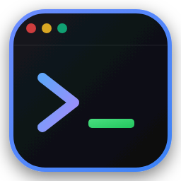
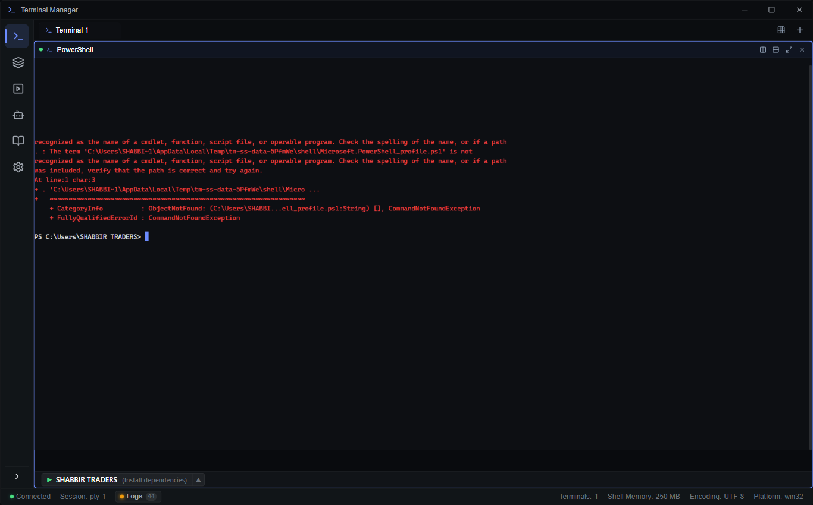
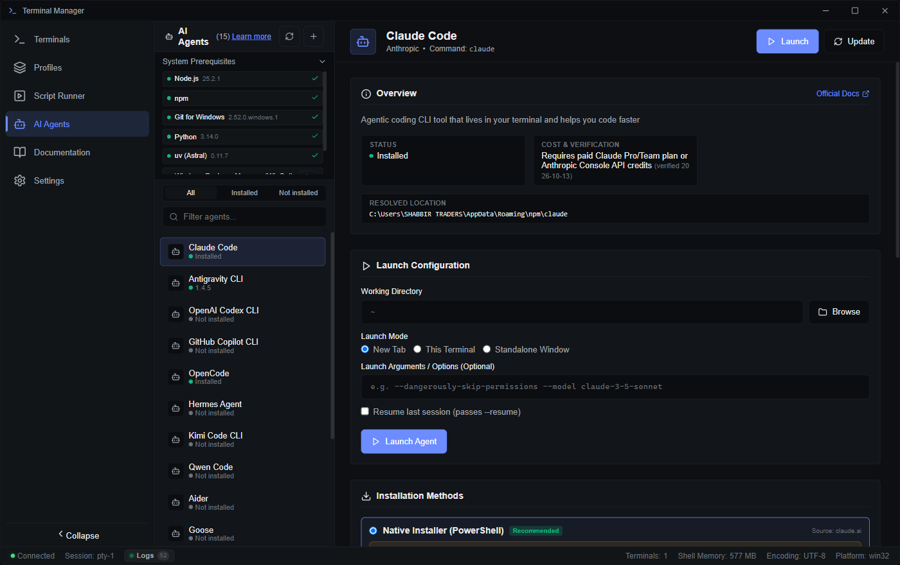
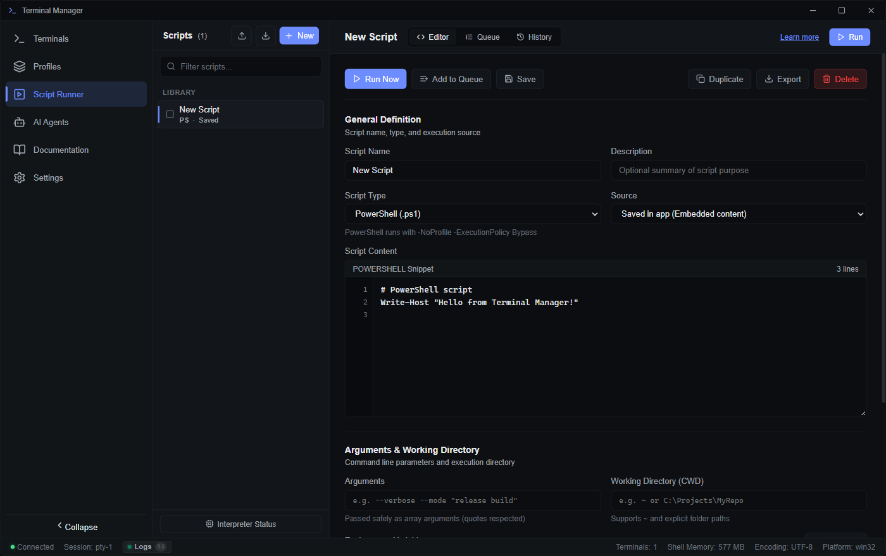
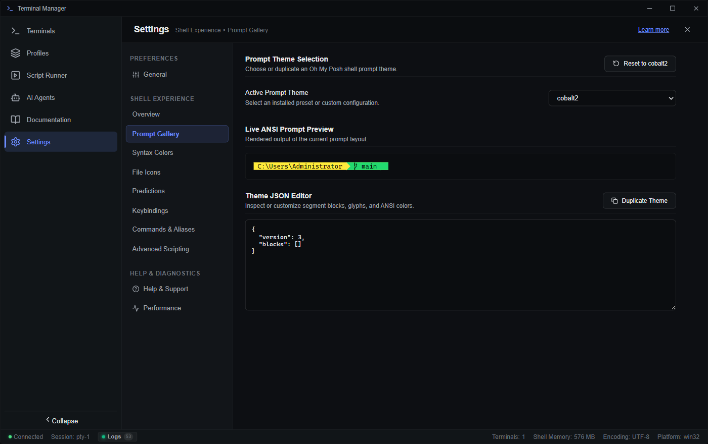
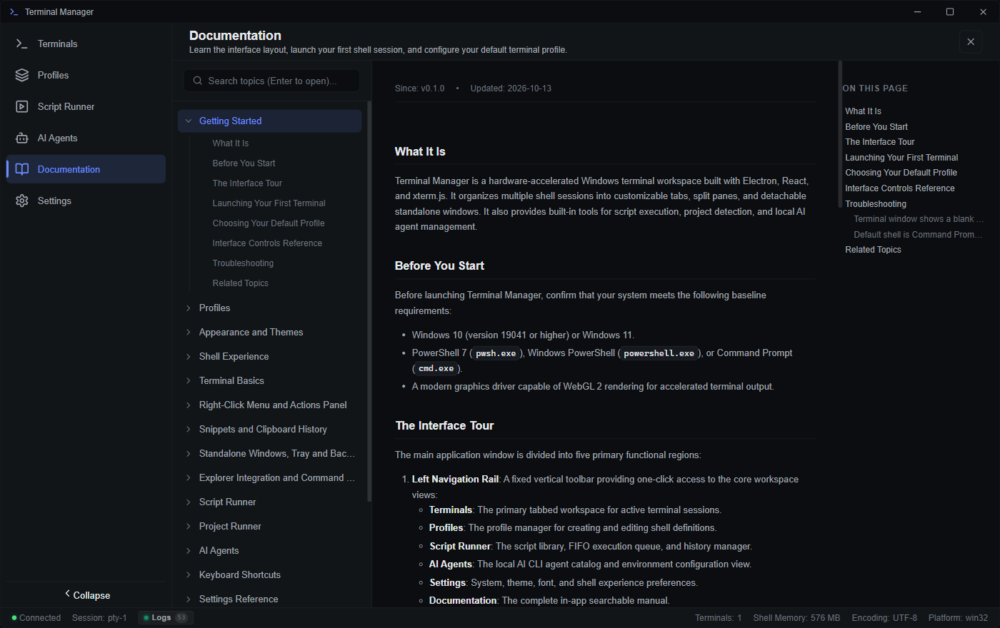

<div align="center">



# Terminal Manager

**A high-performance, hardware-accelerated cross-platform terminal workspace and automation environment.**

[](https://github.com/usernamezain/Terminal-Manager/actions/workflows/ci.yml)
[](https://github.com/usernamezain/Terminal-Manager/releases/latest)
[](LICENSE)
[](https://github.com/usernamezain/Terminal-Manager/releases/latest)
[](https://whatsapp.com/channel/0029VbBUVv35fM5eAnXw3w2D)
[](https://mughal.dev)

[Download & Install](#download--installation) • [For Devs & Vibe Coders](#-how-it-helps-developers-vs-vibe-coders) • [Screenshots](#-application-previews--screenshots) • [Feature Deep-Dive](#-feature-deep-dive) • [Community & Drops](#-join-the-mughaldev-community--exclusive-drops) • [Build from Source](#quickstart-build-from-source) • [Docs & Knowledge Base](#-documentation--knowledge-base)

</div>

---

## 💬 Join the Mughal.dev Community & Exclusive Drops

Stay connected with our developer community and get access to exclusive open-source tools, terminal themes, custom PowerShell scripts, automation presets, and early software releases!

<div align="center">

### 🚀 Official WhatsApp Community Channel
**Daily developer drops, project updates, CLI shortcuts, themes, and community support.**

[](https://whatsapp.com/channel/0029VbBUVv35fM5eAnXw3w2D)

👉 **[Click Here to Join: https://whatsapp.com/channel/0029VbBUVv35fM5eAnXw3w2D](https://whatsapp.com/channel/0029VbBUVv35fM5eAnXw3w2D)**

🌐 *Visit **[mughal.dev](https://mughal.dev)** for web development resources, premium software templates, and technical guides.*

</div>

---

## 📸 Application Previews & Screenshots

<div align="center">

### 1. Main Terminal Workspace (Hardware-Accelerated & Multi-Pane)
*WebGL-rendered terminal tabs with vertical and horizontal split panes, status monitoring, and quick shell switching.*
<br/><br/>

<br/><br/>

### 2. AI Coding Agents Hub
*One-click launch and configuration for 15 CLI AI agents (Claude Code, Antigravity, Copilot CLI, Aider, OpenCode, Hermes, and more).*
<br/><br/>

<br/><br/>

### 3. Automated Script Runner & Task Queue
*Queue, orchestrate, and execute scripts sequentially or concurrently with full log captures and retry policies.*
<br/><br/>

<br/><br/>

### 4. Settings & Shell Customization
*Oh My Posh prompt theming, 17-slot PSReadLine syntax coloring, Fast Start cache, and system integration controls.*
<br/><br/>

<br/><br/>

### 5. In-App Offline Documentation Browser (`F1`)
*Instant full-text searchable offline technical reference rendered directly from native markdown topics.*
<br/><br/>


</div>

---

## ⚡ How It Helps Developers vs. Vibe Coders

Whether you are a seasoned systems software engineer or an AI-first "vibe coder" prompting autonomous agents at full velocity, Terminal Manager is engineered to eliminate terminal friction, prevent workflow disruptions, and accelerate how you build.

| Capability / Pain Point | 🛠️ For Traditional Developers | 🔮 For Vibe Coders (AI Builders) | 🎯 Friction Point Solved |
| :--- | :--- | :--- | :--- |
| **CLI AI Coding Agents** | Run coding agents in isolated sub-shells without polluting your primary build environment or global dependencies. | Launch **15 pre-configured CLI agents** (Claude Code, Antigravity, Aider, Hermes, etc.) with 1 click without setup friction. | Eliminates broken Python virtual environments, missing global binaries, and agent PATH configuration errors. |
| **API Key & Secret Security** | Keep sensitive production tokens and private API keys locked away from repository files and `.env` commits. | Store Anthropic, OpenAI, and Gemini keys with **OS-level DPAPI encryption** (`CryptProtectData`); never leak keys in prompts. | Zero accidental token leaks on GitHub, stream shares, screen recordings, or clipboard history. |
| **Multi-Pane Workspaces** | View compiler output, database logs, live test runners, and git status side-by-side in one window (`Ctrl+Shift+D` / `Ctrl+Shift+E`). | Keep your **AI agent active in Pane 1**, the **dev server in Pane 2**, and **git diffs in Pane 3** simultaneously. | Eliminates chaotic Alt-Tab window switching across dozens of disconnected terminal windows. |
| **High-Throughput Rendering** | WebGL-accelerated 60fps rendering handles massive 50MB+ continuous compiler/docker log dumps without freezing the UI. | Fast streaming tokens render high-speed LLM outputs and massive multi-file code diffs with sub-10ms response latency. | Prevents terminal freezing, UI lockups, and dropped keystrokes during intensive builds or rapid agent generation. |
| **Multi-Ecosystem Project Runner** | Auto-detects targets across **10 ecosystems** (Node.js, Rust, Python, Go, .NET, Java, Ruby, PHP, Make, Docker). | Click-to-run package scripts without needing to memorize syntax for `Cargo.toml`, `npm`, `poetry`, or `mvn`. | Eliminates opening `package.json` or config files just to remember the exact test or start command. |
| **Automated Script Queue** | Execute complex multi-step build, migration, and test sequences with sequential FIFO queuing and retry rules. | Chain automated prompt pipelines and project setup routines (clone ➔ install ➔ seed ➔ launch) without babysitting. | No more manual waiting and copy-pasting command after command between execution steps. |
| **Process Persistence & Detachment** | Shell processes live in the Electron main process; closing or refreshing views never terminates running servers. | Run long-running autonomous agent refactors or benchmarks overnight safely in the **system tray**. | Prevents lost shell state, interrupted agent sessions, or aborted servers when windows close. |
| **PowerShell Customization** | Oh My Posh themes and 17-slot PSReadLine coloring isolated to `CTTcustom.ps1` with sub-800ms Fast Start. | Get a stunning, colorful, modern terminal with git status and path glyphs out of the box with zero dotfile editing. | Eliminates slow PowerShell startup times (>3s) and broken global profile configurations. |
| **Windows Explorer Hook** | Right-click any folder in Windows Explorer to open a ready shell in that directory without admin prompts (`HKCU`). | Instantly jump straight into newly cloned repositories or agent worktrees right from your file manager. | No navigating with tedious `cd C:\Users\...` paths from deep file directory trees. |
| **Offline Technical Reference** | Searchable native documentation browser (`F1`) with complete keyboard shortcut and configuration references. | Instant answers on terminal shortcuts, command options, and troubleshooting without leaving the flow state. | No searching Google or docs websites for basic shortcut and configuration lookups. |

---

### 💡 Why Traditional Developers Love It
1. **Zero UI Freezes**: WebGL rendering pipeline offloads text rasterization to the GPU, preventing terminal lockups even when piping huge files or running verbose compilers.
2. **True Process Resilience**: The Electron main process owns the ConPTY/PTY lifecycle. If the renderer reloads or crashes, background compilations and database sessions continue without disruption.
3. **Non-Elevated Explorer Integration**: Integrates directly into Windows Explorer right-click menus via user-level `HKCU` keys—no UAC administrator prompts required.
4. **App-Scoped Shell Protection**: Custom aliases, prompts, and completions live strictly inside `CTTcustom.ps1`, leaving your system-wide profile clean and intact.

### 🚀 Why Vibe Coders Swear By It
1. **All Your Agents in One Place**: Claude Code, Antigravity, Aider, Copilot, OpenCode, Hermes, and 9 others discovered and launched with single-click ease.
2. **Split & Supervise**: Watch your AI agent edit code in real-time in the left pane while your local Vite or Next.js development server hot-reloads in the right pane.
3. **Safe Credentials**: DPAPI encryption ensures you can stream your coding sessions, share your screen, or record demos without exposing API keys.
4. **Autonomous Pipeline Queue**: Queue multiple scripts (e.g. `npx prisma db push`, `npm run seed`, `npm run dev`) into the FIFO queue and let Terminal Manager handle execution seamlessly.

---

## Download & Installation

Pre-built, ready-to-run packages are compiled by GitHub Actions for **Windows**, **macOS**, and **Linux**. You can download them directly from the table below or visit the [GitHub Releases](https://github.com/usernamezain/Terminal-Manager/releases/latest) page.

| Platform | Format | Architecture | Direct Download |
| :--- | :--- | :--- | :--- |
| **Windows** | Setup Installer (`.exe`) | x64 | [📥 Download Installer](https://github.com/usernamezain/Terminal-Manager/releases/download/v0.1.0/Terminal.Manager.Setup.0.1.0.exe) |
| **Windows** | Standalone Portable (`.exe`) | x64 | [📥 Download Portable](https://github.com/usernamezain/Terminal-Manager/releases/download/v0.1.0/Terminal.Manager.0.1.0.exe) |
| **macOS** | Disk Image (`.dmg`) | Apple Silicon (`arm64`) | [📥 Download DMG](https://github.com/usernamezain/Terminal-Manager/releases/download/v0.1.0/Terminal.Manager-0.1.0-arm64.dmg) |
| **macOS** | Application Archive (`.zip`) | Apple Silicon (`arm64`) | [📥 Download ZIP](https://github.com/usernamezain/Terminal-Manager/releases/download/v0.1.0/Terminal.Manager-0.1.0-arm64-mac.zip) |
| **Linux** | Universal AppImage (`.AppImage`) | x64 | [📥 Download AppImage](https://github.com/usernamezain/Terminal-Manager/releases/download/v0.1.0/Terminal.Manager-0.1.0.AppImage) |
| **Linux** | Debian / Ubuntu Package (`.deb`) | x64 | [📥 Download DEB](https://github.com/usernamezain/Terminal-Manager/releases/download/v0.1.0/terminal-manager_0.1.0_amd64.deb) |
| **All Platforms**| SHA-256 Checksums | — | [📄 View SHA256SUMS.txt](https://github.com/usernamezain/Terminal-Manager/releases/download/v0.1.0/SHA256SUMS.txt) |

---

### Installation Instructions by Platform

#### 🪟 Windows (Windows 10 / 11)

**Option A: Setup Installer (Recommended)**
1. Download [Terminal.Manager.Setup.0.1.0.exe](https://github.com/usernamezain/Terminal-Manager/releases/download/v0.1.0/Terminal.Manager.Setup.0.1.0.exe).
2. Run the installer to install Terminal Manager to your user profile and create desktop & start menu shortcuts.
3. *Windows SmartScreen Note*: If Windows displays *"Windows protected your PC"*, click **More info** and then click **Run anyway** (this is standard for open-source applications without costly enterprise code-signing certificates).

**Option B: Standalone Portable (No Installation Required)**
1. Download [Terminal.Manager.0.1.0.exe](https://github.com/usernamezain/Terminal-Manager/releases/download/v0.1.0/Terminal.Manager.0.1.0.exe).
2. Double-click to launch directly from any folder or USB drive without writing registry installation keys.

**Windows Explorer Context Menu Integration:**
- Inside Terminal Manager, press `Ctrl+,` to open **Settings > System Integration**.
- Click **"Register Context Menu"** to enable the non-elevated right-click *"Open in Terminal Manager"* option on any folder in Windows Explorer.

---

#### 🍎 macOS (Apple Silicon M1 / M2 / M3 / M4)

1. Download [Terminal.Manager-0.1.0-arm64.dmg](https://github.com/usernamezain/Terminal-Manager/releases/download/v0.1.0/Terminal.Manager-0.1.0-arm64.dmg).
2. Double-click the `.dmg` file to mount it, then drag **Terminal Manager** into your `/Applications` folder.
3. Open Terminal Manager from Spotlight or Applications.
4. *macOS Gatekeeper Note*: Because community builds are ad-hoc signed, macOS may show *"Terminal Manager cannot be opened because Apple cannot check it for malicious software"*. To open:
   - **Right-click (or Control-click)** the app in Finder and choose **Open**, then click **Open** in the dialog.
   - Or run this command in your terminal:
     ```bash
     xattr -cr /Applications/Terminal\ Manager.app
     ```

---

#### 🐧 Linux (Ubuntu, Debian, Fedora, Arch, Linux Mint, etc.)

**Option A: Universal AppImage (Runs on all distributions)**
1. Download [Terminal.Manager-0.1.0.AppImage](https://github.com/usernamezain/Terminal-Manager/releases/download/v0.1.0/Terminal.Manager-0.1.0.AppImage).
2. Make it executable and run:
   ```bash
   chmod +x Terminal.Manager-0.1.0.AppImage
   ./Terminal.Manager-0.1.0.AppImage
   ```

**Option B: Debian / Ubuntu Package (`.deb`)**
1. Download [terminal-manager_0.1.0_amd64.deb](https://github.com/usernamezain/Terminal-Manager/releases/download/v0.1.0/terminal-manager_0.1.0_amd64.deb).
2. Install via terminal:
   ```bash
   sudo dpkg -i terminal-manager_0.1.0_amd64.deb
   sudo apt-get install -f  # Automatically installs any missing system libraries
   ```

---

## 🔍 Feature Deep-Dive

Terminal Manager was built from the ground up to solve the friction of modern Windows, macOS, and Linux terminal development. Here is how each major feature works:

### 1. 🖥️ Hardware-Accelerated Terminal Subsystem
- **Engine**: Built on `@xterm/xterm` powered by `@xterm/addon-webgl` for smooth 60fps GPU-accelerated rendering.
- **Latency**: Sub-10ms keystroke-to-echo response time with high-throughput streams (50MB+ continuous text without freezing the UI).
- **Process Model**: ConPTY pseudo-terminals on Windows and POSIX PTYs on macOS/Linux managed entirely inside the Electron main process. If a renderer window crashes or reloads, background shell sessions continue running uninterrupted.
- **Warm Shell Pool**: Pre-warms shell instances in the background so opening a new tab feels instant (<50ms).

### 2. 🗂️ Multi-Pane & Detachable Window Workspaces
- **Split Panes**: Split any terminal vertically (`Ctrl+Shift+D`) or horizontally (`Ctrl+Shift+E`) infinitely.
- **Spatial Navigation**: Move focus between panes intuitively using `Alt+Left`, `Alt+Right`, `Alt+Up`, and `Alt+Down`.
- **Detached Windows**: Pop any terminal tab into a standalone OS desktop window. Detached windows can be independently placed on secondary monitors and re-docked back into the main workspace anytime.

### 3. 🤖 AI Coding Agents Hub
- **Curated Catalog**: Built-in discovery and launcher for 15 CLI AI coding agents:
  - **Claude Code** (`claude`)
  - **Antigravity** (`antigravity`)
  - **Codex CLI** (`codex`)
  - **GitHub Copilot CLI** (`copilot`)
  - **Aider** (`aider`)
  - **OpenCode** (`opencode`)
  - **Hermes Agent** (`hermes`)
  - **Goose CLI** (`goose`)
  - **Devin CLI** (`devin`)
  - **Mentat** (`mentat`)
  - **Sweep** (`sweep`)
  - **GPT-Researcher** (`gpt-researcher`)
  - **AutoGPT** (`autogpt`)
  - **MetaGPT** (`metagpt`)
  - **ChatDev** (`chatdev`)
- **Credential Vault**: DPAPI-encrypted credential storage on Windows (`CryptProtectData`) to securely keep API tokens safe.
- **Environment Refresh**: Automatically scans and injects Python virtual environments, Node global paths, and Cargo bins directly into running agent sessions.

### 4. ⚙️ Multi-Ecosystem Project Runner
- **Zero Configuration**: Open any codebase, and Terminal Manager automatically detects build, test, and run scripts without modifying any project files.
- **10 Supported Ecosystems**:
  - **Node.js**: `npm`, `pnpm`, `yarn`, `bun` (`package.json`)
  - **Rust**: `cargo run`, `cargo test`, `cargo build` (`Cargo.toml`)
  - **Python**: `pip`, `poetry`, `pipenv`, `uv`, `pytest`, `manage.py`, `app.py`
  - **Go**: `go run`, `go test`, `go build` (`go.mod`)
  - **.NET**: `dotnet run`, `dotnet test` (`*.csproj`, `*.sln`)
  - **Java**: Maven (`mvn`), Gradle (`gradlew`, `build.gradle`)
  - **Ruby**: Bundler, Rails, Rake (`Gemfile`)
  - **PHP**: Composer, Artisan (`composer.json`)
  - **Make**: Target discovery from `Makefile`
  - **Docker**: `docker-compose.yml` service management
- **One-Click Execution**: Click any script to run it immediately in a dedicated split pane or background task.

### 5. 📜 Automated FIFO Script Runner
- **Task Orchestration**: Execute automated sequences of scripts with configurable queue order.
- **Multi-Interpreter**: Supports PowerShell (`.ps1`), Windows Command Prompt (`.bat`, `.cmd`), Bash (`.sh`), Node.js (`.js`, `.mjs`), and Python (`.py`).
- **Resilience & Control**: Per-script timeout limits, retry counters, and `onFailure: 'stop' | 'continue'` rules.
- **Persistent Logs**: Retains full terminal execution logs, exit codes, and timestamps for post-mortem debugging.

### 6. 🎨 PowerShell 7 & Shell Customization
- **App-Scoped Profile**: Isolates customizations to `CTTcustom.ps1` so system-wide PowerShell profiles are never modified without explicit consent.
- **Oh My Posh Integration**: Select, preview, and apply popular Oh My Posh prompt themes (`atomic`, `jandedobbeleer`, `agnoster`, etc.).
- **PSReadLine Syntax Palette**: Full 17-slot syntax coloring controls (Commands, Parameters, Strings, Operators, Variables, Errors).
- **Fast Start Caching**: Pre-compiles module manifests to slash PowerShell startup time below 800ms.

### 7. 🔔 Non-Elevated System Integration
- **Windows Explorer Right-Click**: Adds "Open in Terminal Manager" to folders and drive roots using user-level HKCU registry keys (no administrator elevation required).
- **System Tray Residency**: Minimize Terminal Manager to the system tray to keep long-running development servers and watchers active in the background.
- **CLI Parameter Forwarding**: Single-instance architecture enables running `terminal-manager --cwd "C:\MyProject"` from external scripts without spawning redundant app windows.

---

## ⌨️ Essential Keyboard Shortcuts

| Shortcut | Action | Scope |
| :--- | :--- | :--- |
| `Ctrl+Shift+T` | Open New Terminal Tab | Global |
| `Ctrl+Shift+W` | Close Active Tab / Pane | Global |
| `Ctrl+Shift+D` | Split Active Pane Vertically | Workspace |
| `Ctrl+Shift+E` | Split Active Pane Horizontally | Workspace |
| `Alt+Arrows` | Navigate Focus Between Panes (Left/Right/Up/Down) | Workspace |
| `Ctrl+Tab` / `Ctrl+Shift+Tab` | Switch to Next / Previous Tab | Global |
| `Ctrl+Shift+O` | Pop Tab into Standalone Window | Active Tab |
| `Ctrl+Shift+G` | Open AI Agents Hub | Navigation |
| `Ctrl+Shift+R` | Open Script Runner & Task Queue | Navigation |
| `Ctrl+,` | Open Settings & Customizer | Navigation |
| `F1` | Open In-App Documentation Browser | Global |
| `Ctrl+Shift+F` | Search Active Terminal Scrollback | Terminal |
| `Ctrl+Shift+C` / `Ctrl+Shift+V` | Copy / Paste Terminal Text | Terminal |

*All keybindings can be customized in **Settings (`Ctrl+,`) > Keyboard Shortcuts**.*

---

## 📚 Documentation & Knowledge Base

Terminal Manager includes 19 comprehensive documentation guides built into the repository. You can read them directly on GitHub or press `F1` inside the app for the full-text searchable reader:

| Guide | Description | Path |
| :--- | :--- | :--- |
| **01. Getting Started** | Installation, system requirements, first launch | [Read Guide](docs/content/01-getting-started.md) |
| **02. Terminal Profiles** | Configuring PowerShell, CMD, WSL, Git Bash, and custom shells | [Read Guide](docs/content/02-profiles.md) |
| **03. Appearance & Themes** | CSS tokens, color schemes, font styling, and background materials | [Read Guide](docs/content/03-appearance-and-themes.md) |
| **04. Shell Experience** | Oh My Posh themes, PSReadLine syntax coloring, and Fast Start | [Read Guide](docs/content/04-shell-experience.md) |
| **05. Terminal Basics** | xterm.js navigation, scrollback buffers, and WebGL rendering | [Read Guide](docs/content/05-terminal-basics.md) |
| **06. Context Menu & Actions** | Right-click menus, actions panel, and quick commands | [Read Guide](docs/content/06-right-click-menu-and-actions-panel.md) |
| **07. Snippets & Clipboard** | Saving reusable command snippets and clipboard history | [Read Guide](docs/content/07-snippets-and-clipboard-history.md) |
| **08. Standalone & Tray** | Detaching windows, system tray residency, and background timers | [Read Guide](docs/content/08-standalone-windows-tray-and-background.md) |
| **09. Explorer & CLI** | HKCU Windows Explorer context menus and single-instance CLI flags | [Read Guide](docs/content/09-explorer-integration-and-command-line.md) |
| **10. Script Runner** | Automated task queue, interpreter support, and retry policies | [Read Guide](docs/content/10-script-runner.md) |
| **11. Project Runner** | Auto-detection across 10 ecosystems and one-click script runs | [Read Guide](docs/content/11-project-runner.md) |
| **12. AI Agents** | 15 CLI AI agents catalog, DPAPI credential security, and launcher | [Read Guide](docs/content/12-ai-agents.md) |
| **13. Keyboard Shortcuts** | Comprehensive generated reference of all default shortcuts | [Read Guide](docs/content/_generated/13-keyboard-shortcuts.md) |
| **14. Settings Reference** | Full schema documentation for all user settings | [Read Guide](docs/content/_generated/14-settings-reference.md) |
| **15. Performance Guide** | Benchmarks, memory limits, and cold start optimizations | [Read Guide](docs/content/15-performance.md) |
| **16. Troubleshooting & FAQ** | Solutions for ConPTY, WSL, path quoting, and driver issues | [Read Guide](docs/content/16-troubleshooting-and-faq.md) |
| **17. Security & Privacy** | Process sandboxing, DPAPI encryption, and redacted diagnostics | [Read Guide](docs/content/17-security-and-privacy.md) |
| **18. What's New** | Feature milestones, changelogs, and upgrade notes | [Read Guide](docs/content/18-whats-new.md) |
| **19. Glossary** | Definitions of technical terminal, PTY, and Electron concepts | [Read Guide](docs/content/19-glossary.md) |

---

## Quickstart (Build from Source)

If you prefer building from source rather than downloading the pre-built packages:

### Prerequisites
- **Node.js**: `v20.x` or `v22.x` LTS.
- **npm**: `v10.x` or higher.
- **Native Build Tools**: Visual Studio Build Tools with C++ (Windows), Xcode CLI tools (macOS), or `build-essential` (Linux).

### 1. Clone the Repository

```bash
git clone https://github.com/usernamezain/Terminal-Manager.git
cd Terminal-Manager
```

### 2. Install Dependencies & Build Native Bindings

```bash
npm install
npm run rebuild
```

### 3. Launch Development Server

```bash
npm run dev
```

Vite launches on `localhost:5173` with Hot Module Replacement (HMR) and Electron starts automatically.

### 4. Open Any Folder Directly

```powershell
npm start -- --cwd "C:\Projects\my-project"
```

---

## Contributing

We welcome contributions from the community! Please read our full step-by-step guide:

👉 **[HOW-TO-CONTRIBUTE.md](HOW-TO-CONTRIBUTE.md)** (or [CONTRIBUTING.md](CONTRIBUTING.md))

### Automated Verification Pipeline
Every pull request must pass all 5 verification gates before merge:
```bash
npm run docs:check   # Documentation integrity & zero broken links
npx tsc --noEmit     # TypeScript type-safety (0 errors)
npx vitest run       # 149/149 unit and acceptance tests passing
npm run build        # Clean production bundle compile
```

---

## Reporting Issues & In-App Diagnostics

Found a bug or need help?
- **Create an Issue**: Select a template from [GitHub Issues](https://github.com/usernamezain/Terminal-Manager/issues/new/choose).
- **In-App Redacted Diagnostics**: In Terminal Manager, open **Settings (`Ctrl+,`) > Help & Support** and click **Copy Diagnostics**. This copies a sanitized system snapshot with your username, user paths, and API keys automatically stripped (`%USERPROFILE%`, `%USERNAME%`, `[REDACTED_SECRET]`).

---

## License

This project is licensed under the [MIT License](LICENSE).
Copyright (c) 2026 MughalDev and Terminal Manager Contributors.
